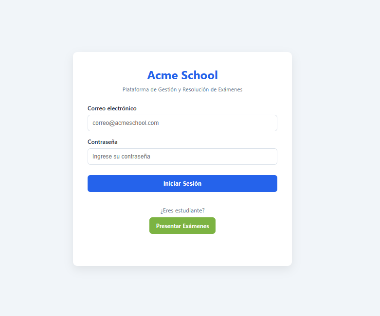
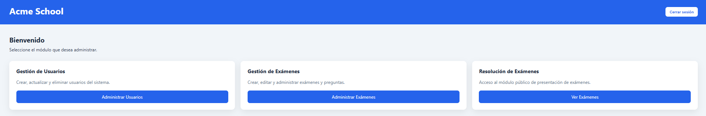
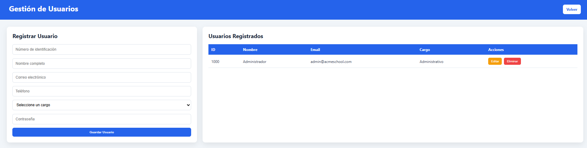
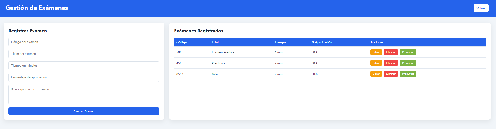
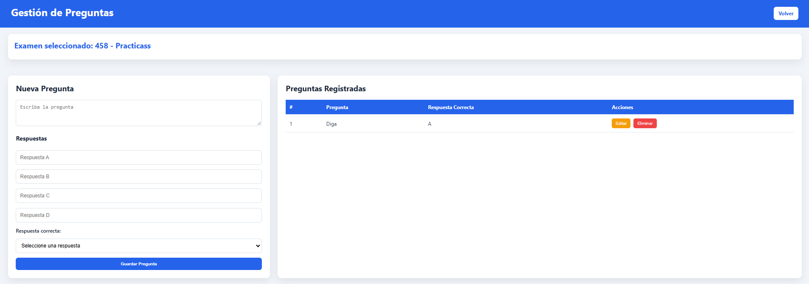
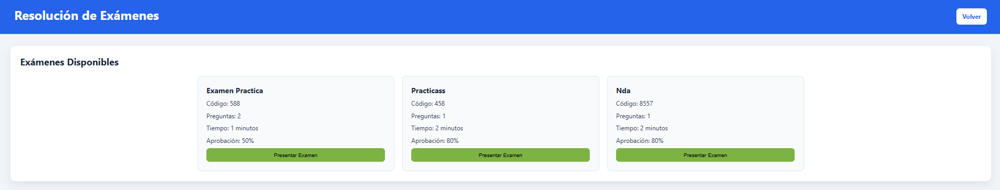
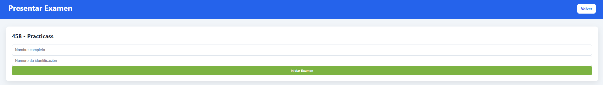
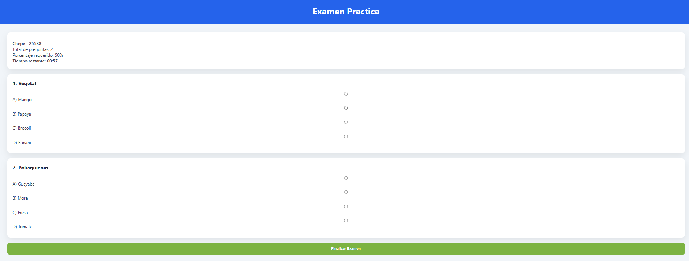
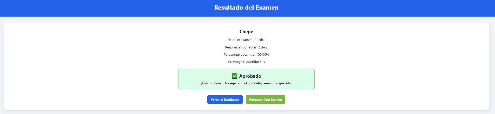

# 🎓 Proyecto Acme School

Sistema web desarrollado en JavaScript para la gestión y resolución de exámenes en línea.

---

# 🔗 Repositorio

**GitHub**

👉 https://github.com/Diego-Gomez-Vi/ProyectoAcmeschool_JavaScript_DiegoGomez

---

# 🎯 Objetivo del Proyecto

Desarrollar una plataforma web que permita a usuarios administrativos y docentes gestionar exámenes académicos de forma digital, mientras que los estudiantes puedan presentar evaluaciones de manera pública sin necesidad de autenticarse.

La aplicación permite:

- Gestionar usuarios.
- Gestionar exámenes.
- Gestionar preguntas y respuestas.
- Resolver exámenes en línea.
- Controlar el tiempo de resolución mediante temporizador.
- Calcular automáticamente los resultados.
- Determinar si el estudiante aprueba o no según el porcentaje definido para cada examen.

---

# 📖 Descripción

Acme School es una plataforma educativa orientada a la creación y presentación de exámenes a través de la web.

Los usuarios administrativos pueden gestionar toda la información relacionada con exámenes y preguntas, mientras que los estudiantes pueden presentar exámenes públicos y obtener resultados automáticos.

La persistencia de información se implementó utilizando Local Storage, conforme a los requisitos establecidos.

---

# 🚀 Tecnologías Utilizadas

- HTML5
- CSS3
- JavaScript ES6
- Local Storage
- Web Components
- Git
- GitHub

---

# ✨ Funcionalidades

## 🔐 Módulo de Autenticación

Permite el acceso a los módulos privados de la aplicación.

### Características

- Inicio de sesión.
- Usuario administrador predeterminado.
- Persistencia de sesión.
- Protección de rutas.
- Cierre de sesión.

### Captura



---

## 📊 Dashboard

Panel principal de navegación para usuarios autenticados.

### Captura



---

## 👥 Gestión de Usuarios

CRUD completo para la administración de usuarios.

### Funcionalidades

- Crear usuarios.
- Listar usuarios.
- Editar usuarios.
- Eliminar usuarios.
- Validación de identificación única.
- Validación de correo electrónico único.

### Captura



---

## 📝 Gestión de Exámenes

CRUD completo para la administración de exámenes.

### Funcionalidades

- Crear exámenes.
- Listar exámenes.
- Editar exámenes.
- Eliminar exámenes.
- Validación de código único.

### Captura



---

## ❓ Gestión de Preguntas

Cada examen permite registrar preguntas y respuestas.

### Funcionalidades

- Crear preguntas.
- Listar preguntas.
- Editar preguntas.
- Eliminar preguntas.
- Cuatro respuestas por pregunta.
- Selección de una única respuesta correcta.

### Captura



---

## 🌐 Resolución Pública de Exámenes

Los estudiantes pueden resolver exámenes sin iniciar sesión.

### Funcionalidades

- Consulta de exámenes disponibles.
- Visualización de:
  - Nombre del examen.
  - Tiempo.
  - Porcentaje requerido.
  - Número de preguntas.
- Selección del examen.

### Captura



---

## 📋 Registro del Estudiante

Antes de iniciar el examen se solicita:

- Nombre completo.
- Número de identificación.

### Captura



---

## ⏱️ Temporizador

Cada examen dispone de un tiempo configurable.

### Funcionalidades

- Cuenta regresiva en tiempo real.
- Finalización automática al finalizar el tiempo.
- Integración mediante Web Component.

### Captura



---

## 📈 Evaluación Automática

La plataforma calcula automáticamente:

- Respuestas correctas.
- Total de preguntas.
- Porcentaje obtenido.
- Comparación con porcentaje requerido.

### Captura



---

# 🧩 Web Components Implementados

El proyecto incorpora Web Components para cumplir los requisitos de modularización.

---

## Navbar Component

```html
<navbar-component></navbar-component>
```

Componente reutilizable para encabezados.

---

## Exam Card Component

```html
<exam-card></exam-card>
```

Componente utilizado para mostrar los exámenes disponibles en la página pública de resolución.

---

## Timer Component

```html
<timer-component></timer-component>
```

Componente encargado de mostrar el temporizador del examen.

---

# 💾 Persistencia de Datos

Toda la información se almacena utilizando:

```javascript
localStorage
```

Se almacenan:

- Usuarios.
- Exámenes.
- Preguntas.
- Resultados.
- Sesiones.
- Datos temporales de resolución.

---

# 📂 Estructura del Proyecto

```text
ProyectoAcmeschool_JavaScript_DiegoGomez

├── assets
│   ├── css
│   │   ├── dashboard.css
│   │   ├── examen.css
│   │   ├── examenes.css
│   │   ├── login.css
│   │   ├── preguntas.css
│   │   ├── resolver.css
│   │   ├── resultado.css
│   │   ├── style.css
│   │   └── usuarios.css
│   │
│   └── img
│       ├── dashboard.png
│       ├── examen.png
│       ├── examenes.png
│       ├── login.png
│       ├── preguntas.png
│       ├── presentar-examen.png
│       ├── resolver.png
│       ├── resultado.png
│       └── usuarios.png
│
├── js
│   ├── auth
│   │   └── login.js
│   │
│   ├── components
│   │   ├── card-examen.js
│   │   ├── navbar.js
│   │   └── timer.js
│   │
│   ├── data
│   │   └── storage.js
│   │
│   ├── exams
│   │   ├── examenes.js
│   │   ├── preguntas.js
│   │   └── temporizador.js
│   │
│   ├── resolver
│   │   ├── examen.js
│   │   ├── presentar-examen.js
│   │   ├── resolver.js
│   │   └── resultado.js
│   │
│   ├── users
│   │   └── usuarios.js
│   │
│   ├── app.js
│   └── dashboard.js
│
├── dashboard.html
├── examen.html
├── examenes.html
├── index.html
├── preguntas.html
├── presentar-examen.html
├── resolver.html
├── resultado.html
├── usuarios.html
│
├── .gitignore
└── README.md
```
```

---

# ⚙️ Instalación

Clonar el repositorio:

```bash
git clone https://github.com/Diego-Gomez-Vi/ProyectoAcmeschool_JavaScript_DiegoGomez.git
```

Entrar al directorio:

```bash
cd ProyectoAcmeschool_JavaScript_DiegoGomez
```

Ejecutar el proyecto utilizando:

```text
Live Server
```

en Visual Studio Code.

---

# 🔑 Usuario Administrador Predeterminado

```text
Correo:
admin@acmeschool.com

Contraseña:
123456
```

---

# 📸 Capturas del Sistema

## Captura

<p align="center">
  
</p>

## Dashboard


## Usuarios


## Exámenes


## Preguntas


## Resolver Examen


## Presentar Examen


## Examen


## Resultado


---

# 👨‍💻 Autor

**Diego Gómez**

Proyecto desarrollado como evidencia final del módulo de JavaScript.

---

# ✅ Estado del Proyecto

Proyecto finalizado.

### Funcionalidades implementadas

✅ Autenticación

✅ Gestión de usuarios

✅ Gestión de exámenes

✅ Gestión de preguntas

✅ Resolución pública de exámenes

✅ Temporizador

✅ Evaluación automática

✅ Resultados

✅ Web Components

✅ Persistencia mediante Local Storage

---

# 📌 Conclusiones

Este proyecto permitió aplicar los conocimientos adquiridos durante el módulo de JavaScript, incluyendo:

- Manipulación avanzada del DOM.
- Modularización del código.
- Uso de Local Storage.
- Gestión de eventos.
- Programación orientada a componentes.
- Persistencia de información.
- Creación de interfaces dinámicas.
- Desarrollo completo de una aplicación web 